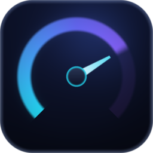

# Internet Speed Monitor

Medidor de velocidade de internet para Windows, com interface dark premium e
medição real (nenhum valor é simulado).



## O que ele mede

| Métrica | Como é obtida |
|---|---|
| **Download** | 6 conexões paralelas baixando dados incompressíveis por 12 s |
| **Upload** | 4 conexões paralelas enviando POSTs de tamanho conhecido por 10 s |
| **Ping** | Mediana de 16 medições de TTFB, descontando o tempo de processamento do servidor |
| **Jitter** | Média das variações absolutas entre pings consecutivos |

Também são registrados: pico sustentado de 2 s, dados baixados, dados enviados,
total transferido, duração total e uma nota de 0 a 100 para a conexão.

## Servidores

- **Cloudflare** (`speed.cloudflare.com`) — download, upload e detecção do
  datacenter mais próximo. É a mesma infraestrutura do speed test oficial deles.
- **CacheFly** — fallback automático de download. A Cloudflare aplica rate limit
  por janela curta; se ela responder HTTP 429, o app troca de servidor sozinho e
  avisa na tela.

## Precisão da medição

Dois cuidados fazem a diferença entre um número bonito e um número correto:

**Velocidade instantânea ≠ velocidade final.** Os bytes são agrupados em bins de
100 ms. O velocímetro anima com a taxa dos últimos 800 ms, mas o resultado
oficial descarta a rampa de aceleração do TCP (os primeiros 25%, no mínimo 1,5 s)
e o último bin parcial, calculando a vazão agregada só da janela estável.

**O upload não conta bytes escritos no socket.** O callback de `req.write()`
dispara quando o chunk entra no buffer do sistema, não quando sai da máquina —
medir por ali inflava o resultado em quase 3×. Em vez disso, cada POST tem
`Content-Length` conhecido e é cronometrado até a resposta HTTP, que só chega
depois que o corpo inteiro atravessou a rede. O tamanho de cada POST se ajusta
sozinho para durar ~2 s.

Os números foram conferidos contra `curl` em paralelo durante o desenvolvimento.

## Uso

O aplicativo é autossuficiente: basta abrir o atalho **Internet Speed Monitor**.

- **Espaço** ou **Enter** inicia o teste; durante a medição, o mesmo botão cancela.
- **Esc** cancela o teste ou fecha as configurações.
- Clique em um item do histórico para revisá-lo; clique de novo para voltar.

### Configurações

- **Precisão**: Rápido (~11 s), Padrão (~23 s) ou Preciso (~37 s).
- **Unidade**: Mbps (padrão dos provedores) ou MB/s.
- **Partículas animadas**: desligue para reduzir uso de GPU.
- **Iniciar teste ao abrir**: executa a medição automaticamente na abertura.

## Dados salvos

Histórico (200 testes) e preferências ficam em:

```
%APPDATA%\Internet Speed Monitor\speed-monitor-data.json
```

A gravação é atômica (arquivo temporário + rename), então fechar o app durante a
escrita não corrompe o histórico. O botão de exportar gera um JSON com todos os
testes.

## Desenvolvimento

```bash
npm install        # dependências (baixa o binário do Electron)
npm run icon       # regenera build/icon.ico a partir do desenho em código
npm start          # roda o app
npm run engine-test  # roda só o motor de medição, no terminal
npm run dist       # gera instalador NSIS + executável portátil em dist/
```

Variáveis de ambiente úteis durante o desenvolvimento (ignoradas no app
empacotado):

| Variável | Efeito |
|---|---|
| `SPEEDMON_DEVTOOLS=1` | abre o DevTools |
| `SPEEDMON_SHOT=a.png` | captura a janela (`SPEEDMON_SHOT_DELAY=2000,9000` para vários instantes) |
| `SPEEDMON_EXEC="1500:btn.click()"` | executa JS no renderer, para exercitar a interface |

### Estrutura

```
electron/
  main.js       processo principal, janela e IPC
  preload.js    ponte segura (contextIsolation ligado)
  speedtest.js  motor de medição — Node puro, sem dependências
  store.js      persistência JSON do histórico e preferências
renderer/
  index.html
  css/app.css
  js/app.js        orquestração da interface
  js/gauge.js      velocímetro em canvas
  js/chart.js      gráficos de tempo real e de evolução
  js/particles.js  partículas de fundo
  js/format.js     formatação pt-BR
tools/
  make-icon.js  gera o .ico desenhando pixel a pixel (sem dependências)
  cli-test.js   roda o motor fora do Electron
  bench.js      benchmark cru de download, para conferir o motor
```

Toda a rede roda no processo principal, não no renderer, para que a interface
continue fluida enquanto o teste satura a conexão.

## Licença

MIT
